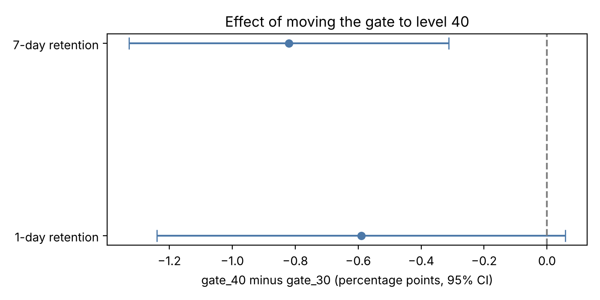
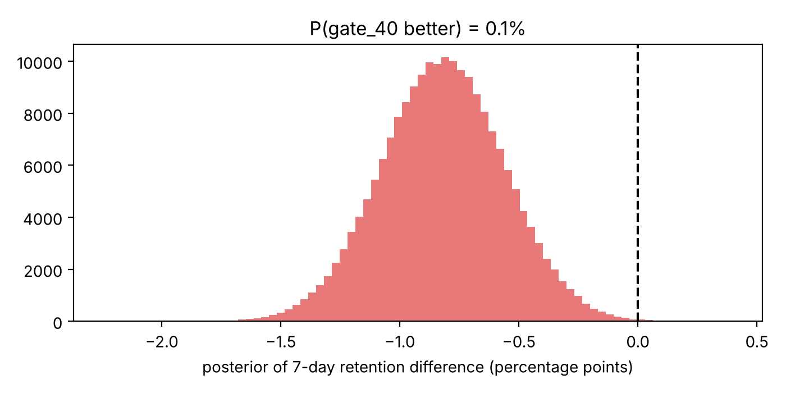

# Cookie Cats gate experiment: results

**Recommendation:** Keep the gate at level 30. Moving it to 40 lowered 7-day retention by a statistically reliable amount.

## Design
Players were split between a control with the first gate at level 30 (`gate_30`) and a treatment with it at level 40 (`gate_40`). Primary metrics: 1-day and 7-day retention. Guardrail: game rounds played. Significance level 5%, with Holm correction across the two retention tests.

## Data checks
- Rows: 90,189; duplicate user ids: 0; unexpected versions: none; null cells: 0
- Group sizes: 44,700 vs 45,489. Sample ratio check (chi-square vs 50/50): p = 0.009 (BORDERLINE (p < 0.05): group sizes are slightly off 50/50, so treat results with some caution)
- Game rounds are heavy-tailed (most rounds by one player: 49,854; 3,994 players never played), so rounds are compared with medians, a rank test and a bootstrap, not just means.

## Retention
| Metric | gate_30 | gate_40 | Difference (95% CI) | p | p (Holm) |
|---|---|---|---|---|---|
| 1-day | 44.82% | 44.23% | -0.59 pp (-1.24 to +0.06) | 0.074 | 0.074 |
| 7-day | 19.02% | 18.20% | -0.82 pp (-1.33 to -0.31) | 0.002 | 0.003 |

## Bayesian view (7-day retention, flat priors)
- Probability gate_40 is better than gate_30: **0.1%**
- 95% credible interval on the difference: -1.33 to -0.31 pp
- Expected loss from shipping gate_40: 0.819 pp of retention

## Game rounds (guardrail)
Median rounds: 17 vs 16. Mean: 52.5 vs 51.3. Mann-Whitney p = 0.050. Bootstrap 95% CI on the mean difference: -4.14 to +0.97. Mean difference with the top 0.1% of players removed: -0.28.

## Regression
Logistic regression of each retention outcome on the treatment indicator (odds ratio for gate_40 vs gate_30), and OLS with robust (HC3) errors on log(1 + game rounds).
- 1-day retention: odds ratio 0.976 (95% CI 0.951 to 1.002), p = 0.074
- 7-day retention: odds ratio 0.947 (95% CI 0.916 to 0.980), p = 0.0016
- Game rounds: -1.8% (95% CI -3.7% to +0.1%), p = 0.070
- No covariates are added on purpose. The data has no pre-experiment player attributes, and adjusting for game rounds would be post-treatment adjustment and would bias the effect. With one binary predictor the odds ratio equals the 2x2 table's cross-product ratio, so the regression agrees with the z-tests by construction.

## A/A simulation (pipeline check)
Before trusting any A/B result, the test pipeline should not find "effects" where none exist. Players were randomly shuffled into two fake arms with the real group sizes, and 7-day retention was tested 2,000 times. False positive rate: **4.7%** (target 5.0%; inside the sampling band). Uniformity of the p-values (Kolmogorov-Smirnov) p = 0.83. The test is well calibrated, so the real gate_30 vs gate_40 result is not an artifact of the method.

## Power
With 44,700 players per group, 80% power and 5% significance, this test could reliably detect a 7-day retention change of about **0.74 pp**. Detecting a 1 pp change needs about **24,658** players per group. A non-significant result means the true effect is probably smaller than that, not that it is zero.

## Limits
- The data has no record of how players were assigned. The analysis assumes random assignment, which the sample ratio check can only partly test.
- Retention is binary and measured at two fixed days, so it says nothing about longer-term behavior or revenue.
- Two primary metrics were tested; Holm correction is applied, and the rounds guardrail is descriptive.

